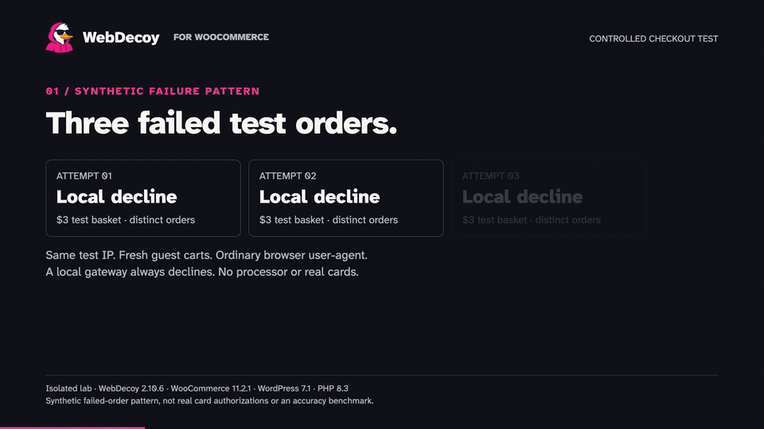

# WebDecoy Bot Detection

[](https://wordpress.org/)
[](https://php.net/)
[](https://www.gnu.org/licenses/gpl-2.0.html)
[](https://github.com/WebDecoy/wordpress-plugin/actions)

Detect bots, protect WordPress forms and WooCommerce checkout, and identify AI crawler traffic. Local protection works without a WebDecoy account or API key. Start in monitor mode, inspect the evidence, and test your site before enabling enforcement.

**[Install WebDecoy from WordPress.org →](https://wordpress.org/plugins/webdecoy/)** · [WordPress setup walkthrough](https://webdecoy.com/wordpress/)

## See WooCommerce checkout protection in action

Three rapid synthetic failed orders. The fourth checkout attempt refused. Separate normal offline test orders accepted on both classic and Blocks checkout.

[](https://youtu.be/pYzsU-EGO_0)

[Watch the full 48-second demo](https://youtu.be/pYzsU-EGO_0) · [Test details and rollout guide](https://webdecoy.com/blog/woocommerce-bot-protection-checkout-carding-fake-orders/)

*Condensed, sped-up excerpts from an isolated lab: WebDecoy 2.10.6, WooCommerce 11.2.1, WordPress 7.1 and PHP 8.3. The failure gateway never contacts a payment processor; normal orders use an offline gateway. This demonstrates one synthetic failed-order pattern, not a production detection rate or live card-payment test. Use 2.10.6 or newer for the classic checkout load-order fix.*

## Features

- **Invisible checks** -- Browser and proof-of-work checks without image puzzles
- **Local protection** -- No WebDecoy account or API key required; review monitor mode and checkout settings before enforcing
- **Multi-layer detection** -- Server-side analysis, client-side fingerprinting, and proof-of-work challenges
- **Good bot verification** -- Reverse DNS verification for Googlebot, Bingbot, and other legitimate crawlers
- **MITRE ATT&CK path analysis** -- Detects admin probing and config file access attempts
- **Rate limiting** -- Automatic blocking with configurable thresholds
- **IP blocking** -- Individual and CIDR ranges, IPv4/IPv6, with optional expiration
- **WooCommerce integration** -- Checkout protection against carding attacks
- **Dashboard & statistics** -- Detection trends, threat breakdown, and recent activity

## Installation

### From WordPress.org

1. Go to **Plugins > Add New** in your WordPress admin
2. Search for "WebDecoy Bot Detection"
3. Click **Install Now**, then **Activate**

### Manual Installation

1. Download the plugin ZIP from the [WordPress.org listing](https://wordpress.org/plugins/webdecoy/)
2. Go to **Plugins > Add New > Upload Plugin**
3. Upload the ZIP file and click **Install Now**
4. Activate the plugin

## Development

### Prerequisites

- PHP 7.4+
- [Composer](https://getcomposer.org/)

### Setup

```bash
composer install
```

### Coding Standards

```bash
composer run phpcs
```

### Static Analysis

```bash
composer run phpstan
```

See [CONTRIBUTING.md](CONTRIBUTING.md) for detailed contribution guidelines.

## License

This project is licensed under the GPL v2 or later. See [license.txt](license.txt) for details.
